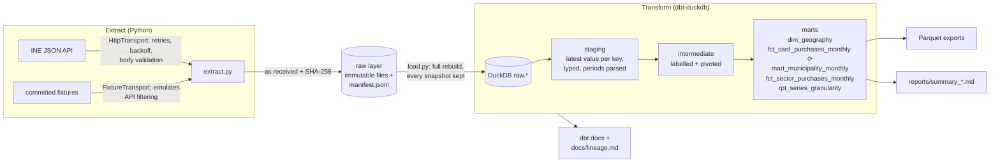

# pt-open-data-pipeline

[](https://github.com/imperiobaal69-web/pt-open-data-pipeline/actions/workflows/ci.yml)

A reproducible ELT pipeline over Portuguese open data: monthly card spending at
point-of-sale terminals, published by INE (Statistics Portugal) from SIBS
payment-network data, for every municipality since January 2020.

Python 3.12 + uv for extraction, DuckDB as the warehouse, dbt for the
transformations and data tests, Parquet for the outputs. It runs fully offline
on committed fixtures (`make all`) or against the live API
(`make all SOURCE=live`).

## The problem

INE publishes the series through a JSON API that is easy to call and easy to
call wrongly. These behaviours are not documented; I found them by testing:

- **Periods must be enumerated.** Leave the period parameter (`Dim1`) empty and
  the API returns only the latest month, without any error. Every month has to
  be listed as `S3A` + `YYYYMM`.
- **Failures arrive as HTTP 200.** When the service is degraded it can return an
  HTML page or a JSON body with `"Sucesso": {"Falso": ...}` and status 200.
- **Long category lists crash it.** Requesting the 915 CAE subclass codes in
  `Dim3` fails server-side with `ORA-06502: character string buffer too small`.
  An empty `Dim3` returns every category instead.
- **The breakdowns never cross.** Spend by channel, spend by card origin and
  spend by economic sector are three separate tables. The sector table exists
  only from February 2026 and only down to NUTS III.

On top of that, the published values contain at least one inconsistency (see
[Findings](#findings)). The pipeline turns this into tables you can trust: every
value traces back to the exact response it came from, and the data rules are
enforced as tests.

## Run it (3 commands)

```bash
git clone https://github.com/imperiobaal69-web/pt-open-data-pipeline.git && cd pt-open-data-pipeline
brew install uv            # or: curl -LsSf https://astral.sh/uv/install.sh | sh
make all                   # offline: fixtures -> DuckDB -> dbt build -> Parquet
```

`make all SOURCE=live` runs the same pipeline against the live INE API. In the
run recorded in [`reports/summary_live.md`](reports/summary_live.md) that was 13
requests (50 MB) and about 8 minutes, most of it waiting for INE.
`make test` runs the test suite, `make ci` runs what CI runs, and
`make docs-serve` opens the dbt docs site with column-level documentation and
the lineage graph.

Outputs land in `data/<source>/`: the raw layer, `warehouse.duckdb`,
`exports/*.parquet` and the dbt artefacts. That directory is git-ignored and can
be rebuilt at any time.

## Architecture



⟳ = incremental model. The model-level lineage, generated from dbt's manifest,
is in [`docs/lineage.md`](docs/lineage.md).

**Extract** (`src/ptdata/extract.py`). For each indicator in
[`series_catalog.csv`](transform/seeds/series_catalog.csv), the extractor fetches
the metadata first. The metadata drives the request: which months exist and,
for the sector tables (1,963 CAE categories), which hierarchy levels to ask for.
Data requests are chunked at 60 months. Every response is validated, then
written atomically as a read-only file named by retrieval time and SHA-256, and
appended to `manifest.jsonl` with URL, timestamp, checksum and size. Nothing in
the raw layer is ever overwritten.

**Load** (`src/ptdata/load.py`). Checks every checksum, then rebuilds the
`raw.*` tables from all snapshots with explicit column types. Old snapshots are
kept rather than replaced, so a revised value never erases the value it
replaced.

**Transform** (`transform/`). Staging picks the most recent snapshot per
(indicator, month, geography, category) and maps INE's Portuguese period labels
to dates through the metadata, not by parsing month names. Intermediate models
label and pivot the series. The marts are the contract below.

## Data contract

| Mart | Grain (unique key) | What it holds |
|---|---|---|
| `dim_geography` | `geo_code` | 347 units: country, 3 NUTS I, 9 NUTS II, 26 NUTS III, 308 municipalities. Parent derived from the hierarchical code. |
| `fct_card_purchases_monthly` | `geo_code, month` | Spend (EUR) total / in-person / online, spend by domestic vs. foreign cards, transaction counts, average ticket, online share, foreign-card share, `source_issue_note`. Incremental. |
| `mart_municipality_monthly` | `geo_code, month` | Municipalities only, with month-on-month and year-on-year change in spend and the year-on-year change in online and foreign-card share. |
| `fct_sector_purchases_monthly` | `geo_code, month, sector_code` | Spend and transactions by CAE Rev.4 section, NUTS III and above, with each section's share of its region. |
| `rpt_series_granularity` | `varcd` | Per indicator: period coverage, finest geography, breakdown depth, what was loaded. |

Money is `DECIMAL(20,2)` in euros; shares are fractions between 0 and 1. A
growth value is NULL when the comparison month is absent or zero, never computed
against a different month.

What the 73 dbt tests guarantee on every build:

- **Keys:** unique and not null at each mart's grain; `relationships` from facts
  to `dim_geography`, from each unit to its parent, and from series to the
  catalog.
- **Ranges:** `accepted_range` on spend, counts and tickets (≥ 0), shares
  (0 to 1) and growth (≥ −100%).
- **Gapless months:** every geography's series is a contiguous run of months
  (custom generic test `gapless_monthly_series`). A missing month would
  otherwise make "previous month" silently mean two months back.
- **Additivity within a table:** in-person + online = total, domestic + foreign
  = total, and CAE sections add up to the region total.
- **Additivity across levels:** the municipalities of each NUTS III region add
  up to the region, for all eight measures. This runs wherever every
  municipality of a region is loaded (all 26 regions live; NUTS III 11A in the
  fixtures).
- **Known issues:** values listed in
  [`known_source_issues.csv`](transform/seeds/known_source_issues.csv) are kept
  as published, flagged in the fact table and excluded from the checks above. A
  warning fires when INE corrects one, so the entry can be removed.

## What the data cannot tell you

These limits are measured, not assumed. Evidence:
[`reports/granularity_probe.md`](reports/granularity_probe.md) (from
`scripts/probe_granularity.py`) and the `rpt_series_granularity` mart.

- **Nothing below the municipality.** The geography dimension (NUTS 2024) has
  five levels, and the finest is the municipality. No figures exist per parish
  (freguesia) or street.
- **No sector by municipality.** The CAE tables stop at NUTS III. Asked for Porto
  municipality, the API answers *"Code(s) in Dim2 not valid for the indicator"*.
  So "restaurant spend in a given parish" or even "in Porto municipality" is not
  publicly available. Withholding small-area × sector cells is the usual
  statistical-confidentiality practice; this repo can only show that the
  combination is not published, not why.
- **No crossed breakdowns.** There is no "foreign cards, online" figure and no
  "foreign cards in restaurants": channel, card origin and sector are separate
  tables with their own totals.
- **Sector history starts in February 2026.** That is 8 months at the time of
  the recorded run, so year-on-year by sector is not possible yet.
- **Sparse detail at the finest sector level.** At CAE subclass × NUTS III
  (Porto metro, September 2026), 336 of 915 published cells are zero.
- **Location means terminal, not resident.** The geography is where the payment
  terminal is (the indicator is purchases "through POS terminals by
  geographic location"). A municipality's online share partly reflects which
  merchants are registered there; in the recorded run it reached 51.9% in
  Espinho. Card origin is only "national" vs. "foreign", with no country.
- **SIBS network only.** These are purchases through the Multibanco network, not
  all consumer spending: cash, and transactions processed outside that network,
  are not counted.

## Findings

From the live run on 2026-10-19 ([full report](reports/summary_live.md)):

- **A published inconsistency.** For Baixo Alentejo (NUTS III 1C2), April 2024,
  INE publishes 0 online transactions, while in-person + online falls 2,553
  short of the published total. The region's 13 municipalities add up to exactly
  2,553 online transactions. Every other one of the 2,106 region-months is fully
  additive. The within-table and cross-level tests both caught it.
- **National totals.** September 2026: €7.77 bn across 248.9 m card purchases,
  up from €7.28 bn a year earlier. Online share was 9.6% (9.2% a year earlier);
  foreign-card share was 14.3% (14.7%).
- **Where foreign cards dominate.** The highest foreign-card shares are in small
  tourist municipalities: Porto Moniz 76.0%, Vila do Bispo 72.2%, Lagos 57.4%.

## Tests

| Suite | Count | Result |
|---|---|---|
| pytest (`make test`) | 40 | 40 passed, about 2 min (most of it the end-to-end dbt runs) |
| dbt tests on fixtures (`make all`) | 73 | 73 passed |
| dbt tests on live data (`make all SOURCE=live`) | 73 | 73 passed (one warn-level check, silent) |
| ruff lint + format | n/a | clean |

The pytest suite runs offline and covers:

- **Extract and raw layer:** period enumeration, chunking, retry and backoff
  (transient errors, 200-with-error-page, no retry on 4xx), and cache behaviour.
  The raw layer is checked for immutability (refuses to overwrite, detects a
  tampered file) and dedups identical responses.
- **End to end (extract → load → `dbt build`):**
  - an incremental run that receives three new months produces exactly the same
    fact table as a full rebuild, and only touches the lookback window;
  - a revised value from INE supersedes the old one while both stay in the raw
    layer;
  - a missing month fails the gapless test, and the following month's growth
    stays NULL;
  - inflating one municipality fails the cross-level test while the within-table
    test still passes.

[`reports/summary_fixtures.md`](reports/summary_fixtures.md) is regenerated by
every fixture run. CI fails if it changes, so it doubles as a regression check
on the numbers.

## Orchestration

- **`make all`:** one entrypoint (extract → load → dbt build → Parquet → report
  → docs). Each step is also a separate target and a `ptdata` subcommand.
- **`.github/workflows/ci.yml`:** on push and pull request it runs ruff, pytest,
  the full fixture pipeline and the report diff check, and uploads the Parquet
  files and dbt docs.
- **`.github/workflows/refresh.yml`:** runs monthly on the 20th (INE published
  the September 2026 data on 2026-10-15) and on demand, against the live API by
  default or fixtures if chosen. It restores the previous `data/` directory from
  the Actions cache, so the fact model runs incrementally across months, then
  uploads the marts as an artifact.

The workflows have not run on GitHub yet: the repository has no remote. `make ci`
runs the same steps locally and passes.

## Design decisions and trade-offs

- **Immutable raw layer, disposable warehouse.** Responses are stored byte for
  byte with checksums, and DuckDB is rebuilt from them. Re-running a
  transformation never needs the API, and any number can be traced to a file and
  a URL. The cost is disk: about 50 MB per full live extract.
- **Metadata-driven extraction.** The list of months to request comes from INE's
  own metadata, so a newly published month is picked up without code changes.
  Metadata is always re-fetched (it is what announces new months); data
  responses are cached by exact URL.
- **Latest snapshot wins, history kept.** Staging takes the newest value per
  key, but every snapshot stays in `raw.ine_observations`. Revisions are visible
  and auditable instead of overwriting history.
- **Incremental with a lookback window.** `fct_card_purchases_monthly` uses
  delete+insert on `(geo_code, month)` and re-processes the last 3 months on
  every run, so recent revisions are picked up. At about 28k rows this is about
  correctness patterns, not speed; the test above proves it is equivalent to a
  full rebuild.
- **Growth by calendar join, not `LAG()`.** Prior periods are found by exact
  month offset. With a gap, `LAG()` would compare against the wrong month; the
  join yields NULL.
- **Known issues are data, not code.** Defects in the published data go in a seed
  with the evidence, stay visible in the output and expire automatically when
  INE fixes them, instead of being patched or filtered silently.
- **Fixtures are real responses.** The fixtures are byte-for-byte API answers for
  a small request (25 geographies, January 2024 onward, built by
  `scripts/build_fixtures.py`). The fixture transport emulates the API's
  filtering, so offline runs exercise the same code paths as live ones,
  including chunking and newly arriving months.
- **Small dependency set.** The runtime needs only `duckdb`, `dbt-core` and
  `dbt-duckdb`. HTTP uses the standard library, Parquet is written by DuckDB
  itself, and dbt uses no external packages, so `dbt deps` and network access
  are not needed to build.
- **Not in scope.** No scheduler service such as Airflow or Dagster: one monthly
  batch over a single source does not need one, and the workflow covers it. No
  dashboard.

## Repository layout

```
src/ptdata/            ine.py (API rules) · transport.py (HTTP / fixtures) · raw.py (raw layer)
                       extract.py · load.py · outputs.py (Parquet, lineage, report) · cli.py
transform/             dbt project: seeds/, models/{staging,intermediate,marts}/, tests/ (custom generic + singular)
tests/                 pytest suite + fixtures/ine/ (real INE responses)
scripts/               build_fixtures.py · probe_granularity.py
reports/               generated run summaries and the granularity probe
docs/lineage.md        generated model lineage
```

## Data licence

Source: INE, Statistics Portugal, from SIBS data, licensed
[CC BY 4.0](https://creativecommons.org/licenses/by/4.0/). The committed
fixtures and reports contain extracts of that data. Code: [MIT](LICENSE).
